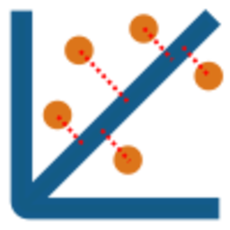

# ODR-app

  

Programa para realizar ajustes por el método *Orthogonal Distance Regresión para modelos polinomiales*.

## Introducción

Los procesos de ajustes de datos experimentales a modelos matemáticos es muy común en la ciencia. Existen varios métodos para realizar ajustes, y la mayoría se basan en la optimización de la distancia de los puntos experimentales a al modelo de ajuste.

Los datos experimentales poseen una incertidumbre, lo cual se puede usar como una función de peso para la optimización. Usualmente los métodos de ajuste permiten añadir una función de peso, usualmente la incertidumbre en la variable $y$ representada como $\mu_{y}$. La función de peso usualmente es $w = \frac{1}{\mu_{y}^2}$. Sin embargo en muchos casos los puntos experimentales tienen incertidumbre tanto en $x$ como en $y$, lo cual no no puede ser contemplado por los métodos usuales. 

El método de *Orthogonal Distance Regresion*(ODR)[^1], busca optimizar la distancia ortogonal a la función de ajuste, lo cuál permite añadir dos funciones de peso, una para $x$ y una para $y$, lo cual lo hace excelente para ajustar datos experimentales con incertidumbres en ambas variables ($\mu_x$, $\mu_y$).

## Algoritmo
El algoritmo de ODR[^2] busca, como todos los demás, ajustar una función matemática ($f$) a un grupo de $n$ puntos experimentales $\{x_{i}, y_{i}\}$, de manera que:

$$
y_{i}=f(x_{i}, \beta) 
\tag{1}
$$

donde $f$ es una función (no necesariamente lineal) con $\beta$ un vector de parámetros. 

En este caso, tanto $x_i$ como $y_i$ presentan *errores* aditivos no conocidos $\delta_{i}$ y $\epsilon_i$ respectivamente, por lo que la función de ajuste se convierte en:

$$
y_i = f(x_i+\delta_i, \beta)-\epsilon_i
\tag{2}
$$

Para optimizar $\beta$ se selecciona la suma cuadrática de las distancias ortogonales de los puntos experimentales a la curva $f$. Esta distancia queda determinada por $r_{i}^{2} = \delta_{i}^{2} +\epsilon_{i}^{2}$.

De manera que la función a minimizar sería:

$$
\min_{\beta, \epsilon, \delta}\sum_{i=1}^{n} r^{2}_i = \min_{\beta, \epsilon, \delta}\sum_{i=1}^{n} (\epsilon_{i}^{2} +\delta_{i}^{2})
\tag{3}
$$

El valor de $\epsilon_{i}$ se puede despejar de la ecuación (2), así que se puede reescribir la ecuación (3) como:

$$
\min_{\beta, \delta}\sum_{i=1}^{n} \left[ \left(f(x_i+\delta_i,\beta)-y_i \right)^{2} + \delta_i ²  \right] \tag{4}
$$

siendo esta la función a optimizar para este método ODR para un grupo de puntos $\{x_i, y_i\}$ con errores no conocidos aditivos $\{\delta_i, \epsilon_i\}$. Se puede hacer una generalización de esta función al pensar que $x_i \in \mathbb{R}^m$, por lo que sus errores también son un vector.

$$
\min_{\beta, \delta}\sum_{i=1}^{n} \left[ \left(f(x_i+\delta_i,\beta)-y_i \right)^{2} + \delta_i^{T} \delta _i  \right]
\tag{5}
$$

donde, $\delta_{i}^{T}$ es el vector transpuesto de los *errores*.

Por ultimo se hace una segunda generalización al introducir funciones de peso $w_i$ y $D_i$ para cada uno de los puntos de manera que todo queda como:

$$
\min_{\beta, \delta}\sum_{i=1}^{n} w^2 \left[ \left(f(x_i+\delta_i,\beta)-y_i \right)^{2} + \delta_i^{T} D_{i}^2 \delta _i  \right]
\tag{6}
$$

Este es el caso más general y la función de optimzación para el método ODR, aunque aplicando las funciones de peso a la ecuación (5) es una forma de verlo para muchos ajustes *simples*. La relación entre las funciones de peso y las incertidumbres son $w_i = \frac{1}{\mu_{y_i}}$ y $D_i = \frac{\mu_{x_i}}{\mu_{y_i}}$ (?).

Este método es completamente no lineal, aún si la función $f$ es lineal. 

## Interfaz

La implementación se realizó con Python con los módulos de `Scypy` y `wx` para la interfaz gráfica.

Se diseñó una interfaz gráfica para realizar ajustes por ODR a un grupo de $n$ puntos experimentales $\{x_i, y_i\}$ con incertidumbres $\{\mu_{x_i},\mu_{y_i}\}$. 

Este programa permite copiar los datos en una tabla con la estructura específica:

|    $x$   |   $\mu_x$   |    $y$   |   $\mu_y$   |
|:--------:|:-----------:|:--------:|:-----------:|
|   $x_1$  | $\mu_{x_1}$ |   $y_1$  | $\mu_{y_1}$ |
|   $x_2$  | $\mu_{x_2}$ |   $y_2$  | $\mu_{y_3}$ |
|   $x_3$  | $\mu_{x_3}$ |   $y_3$  | $\mu_{y_3}$ |
| $\vdots$ |   $\vdots$  | $\vdots$ |   $\vdots$  |
|   $x_n$  | $\mu_{x_n}$ |   $y_n$  | $\mu_{y_n}$ |

La cantidad de filas debe ser definida en la interfaz.

El programa permite graficar los puntos copiados y realizar el ajuste ODR. 

En esta versión del programa se pueden realizar ajustes polinomiales hasta grado 3. Se espera poder generar la versión 2.0 que permita definir una función arbitraria en el futuro. 

El programa fue empaquetado con `Pyinstaller`.

## Referencias
[^1]: Boggs, Paul T., and Paul T. Boggs. "Orthogonal distance regression." (1989): 183-194.

[^2]: Boggs, Paul T., Richard H. Byrd, and Robert B. Schnabel. "A stable and efficient algorithm for nonlinear orthogonal distance regression." SIAM Journal on Scientific and Statistical Computing 8.6 (1987): 1052-1078.